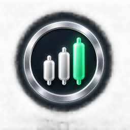

# Zuz

A Telegram trading bot and Mini App for buying tokens on **Robinhood Chain,
Ethereum, Base, Arbitrum, Solana** and **Igra**, the EVM layer on Kaspa.

Paste a contract address, buy from a button, and set the exit before you are in
rather than after.

- **Bot:** [@ZuzTradeBot](https://t.me/ZuzTradeBot)
- **Mini App:** [app.zuztrade.com](https://app.zuztrade.com)
- **Site:** [zuztrade.com](https://zuztrade.com)

> **Early access.** Zuz is live and trading on mainnet, but it is early and
> built by a small team. It is a **hot wallet**: keep only what you trade in it.
> Most memecoins go to zero. Nothing here is financial advice.

---

## What it does

**Exits are set up front.** Every buy can carry a take-profit ladder, a
stop-loss ladder, a trailing take-profit, a time exit and an anti-rug exit, each
selling a chosen percentage of what you still hold. You configure them before
the buy, not after you are already down.

**Take-profit is measured after fees.** A take-profit fires only when the quoted
sell, minus the sell fee, actually beats what you paid including the buy fee by
your target. If no quote is available it falls back to price, so an exit never
gets stuck.

**Stop-losses do not fire on a single candle.** A stop-loss only triggers if the
price is still through the level 15 seconds later, so one block of thin-pool
noise cannot sell you at the bottom. The anti-rug exit is a separate mechanism.

**Paper trading on real prices.** `/paper` gives you $1,000 of play money priced
against the real market and running the real exit ladder, so you can learn the
flow without funding anything.

**Bridging is built in and free.** Between Ethereum, Base, Arbitrum, Robinhood
Chain and Solana, and between Kaspa and Igra. No fee is charged on bridges, and
funds only ever move between your own wallets.

## Chains and fees

| Chain | Trading | Fee |
|---|---|---|
| Robinhood Chain | Uniswap V4 | **1%** |
| Ethereum | Uniswap | 2% |
| Base | Uniswap | 2% |
| Arbitrum | Uniswap | 2% |
| Solana | Jupiter routing | 2% |
| Igra (Kaspa L2) | Zealous | 2% |
| Kaspa L1 | Wallet and bridging only | — |

Fees are charged on the buy and on the sell, win or lose, and only after a buy
is confirmed. A failed swap costs nothing. Bridges are free.

**Cashback.** Part of the fee is returned by 30-day volume: 5% under $1k, 10%
from $1k, 15% from $10k and 20% from $50k. It is never charged in the first
place, so it stays in your wallet in the coin you traded. There is no token and
no pooled fund.

## Signals

Zuz watches new pools on Igra, Robinhood Chain, Ethereum and Base and publishes
alerts. Community calls from partner Discord servers are republished credited to
whoever made the call, each community as its own stream with its own card in the
app's Discover. Streams are opt-in per user with `/signals` and `/communities`.

Signals are not advice. Most memecoins go to zero. Size accordingly.

## Why Igra

Zuz is, as far as we know, the only trading bot that trades Igra, the EVM layer
on Kaspa. Kaspa has a large holder base and almost no execution tooling, and
that gap is the reason this project exists.

Kaspa L1 is wallet and bridging only, because L1 has no token venue. Trading on
Kasplex, the other Kaspa L2, is **deliberately switched off**: its venue has
been too thin to exit safely, and we would rather not offer a trade you can get
into but not out of.

## Partners

Community owners and creators earn a share of the trading fees from users they
bring, taken out of the fee at the moment of each trade and paid to a payout
wallet they set themselves with `/payout`.

Each partner community gets its own signal stream, credited to whoever made each
call, with its own card in the app's Discover and its own join link so members
subscribe to that community's calls alone. An owner can also keep their stream
off the shared public channel.

Ask in [@ZuzSupport](https://t.me/ZuzSupport).

## This repository

Documentation only, for now.

- [`ARCHITECTURE.md`](ARCHITECTURE.md) — how the pieces fit together
- [`SECURITY.md`](SECURITY.md) — custody model and how to report a vulnerability

We are preparing the code for an external security review, and the trading
source stays private until then. We expect to open parts of it afterwards.
Reviewers and ecosystem partners can request read access through the contact in
`SECURITY.md`.

## Links

- Bot — [@ZuzTradeBot](https://t.me/ZuzTradeBot)
- Signals — [@ZuzSignals](https://t.me/ZuzSignals)
- Support — [@ZuzSupport](https://t.me/ZuzSupport)
